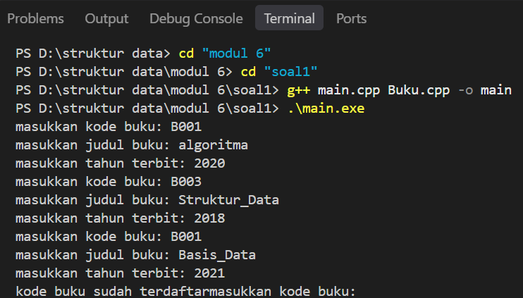
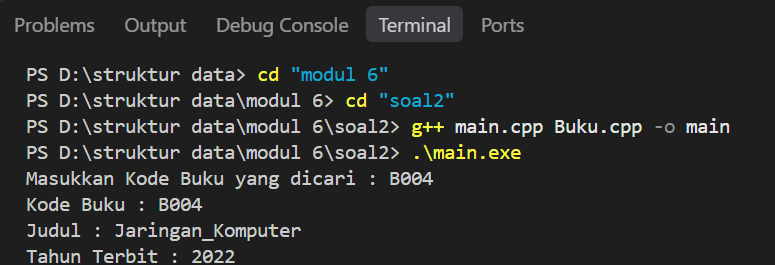
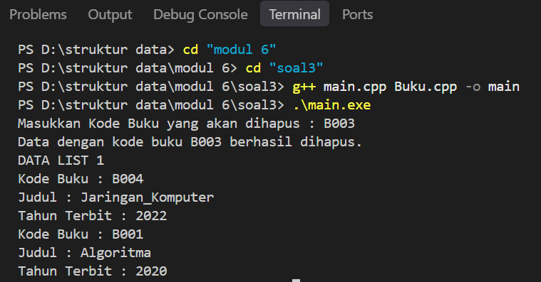

# <h1 align="center">Laporan Praktikum Modul 6 - Doubly Linked List</h1>
<p align="center">Shafira Shifa Azahra - 109082500125</p>

## Dasar Teori
Doubly Linked List adalah linked list yang masing-masing elemennya memiliki dua successor, yaitu successor yang menunjuk pada elemen sebelumnya (`prev`) dan successor yang menunjuk pada elemen sesudahnya (`next`)[1]. Doubly Linked List juga menggunakan dua successor utama yang terdapat pada list, yaitu `first` yang menunjuk elemen pertama dan `last` yang menunjuk elemen terakhir list[1].

### A. Komponen Doubly Linked List<br/>
Komponen-komponen dalam Doubly Linked List adalah sebagai berikut.
#### 1. First
Pointer pada list yang menunjuk pada elemen pertama list.
#### 2. Last
Pointer pada list yang menunjuk pada elemen terakhir list.
#### 3. Next
Pointer pada elemen sebagai successor yang menunjuk pada elemen di depannya.
#### 4. Prev
Pointer pada elemen sebagai successor yang menunjuk pada elemen di belakangnya.

List dinyatakan kosong jika `L.first = Nil`[1].

### B. Insert<br/>
Insert adalah proses menambahkan elemen baru ke dalam list. Elemen baru dibuat terlebih dahulu dengan `P = alokasi(X)`, kemudian `P->next = Nil` dan `P->prev = Nil`[1].
#### 1. Insert First
Menambahkan elemen di awal list. Langkahnya: `P->next = L.first`, `(L.first)->prev = P`, lalu `L.first = P`[1].
#### 2. Insert Last
Menambahkan elemen di akhir list. Langkahnya: `P->prev = L.last`, `(L.last)->next = P`, lalu `L.last = P`[1].
#### 3. Insert After
Menambahkan elemen setelah elemen tertentu (R). Langkahnya: `P->next = R->next`, `P->prev = R`, `(R->next)->prev = P`, lalu `R->prev = P`[1].
#### 4. Insert Before
Insert Before merupakan kebalikan dari Insert After. Perbedaannya terletak pada pencarian elemennya[1].

### C. Delete<br/>
Delete adalah proses menghapus elemen dari list. Elemen yang dihapus ditampung pada pointer `P`, kemudian dikembalikan (`return P`) atau dibebaskan dengan `dealokasi(P)`[1].
#### 1. Delete First
Menghapus elemen pertama. Langkahnya: `P = L.first`, `L.first = (L.first)->next`, `P->prev = Nil`, `(L.first)->prev = Nil`, lalu `P->next = Nil`[1].
#### 2. Delete Last
Menghapus elemen terakhir. Langkahnya: `P = L.last`, `L.last = (L.last)->prev`, `P->prev = Nil`, lalu `(L.last)->next = Nil`[1].
#### 3. Delete After
Menghapus elemen setelah elemen tertentu (R). Langkahnya: `R->next = P->next`, `(P->next)->prev = R`, lalu `P->prev = Nil` dan `P->next = Nil`[1].
#### 4. Delete Before
Delete Before merupakan kebalikan dari Delete After. Perbedaannya terletak pada pencarian elemennya[1].

### D. Update, View, dan Searching<br/>
Proses pencarian, update data, dan view data pada dasarnya sama dengan proses pada Singly Linked List. Perbedaannya, pada Doubly Linked List akses elemen lebih mudah karena iterasi dapat dilakukan maju dan mundur. ADT pada Doubly Linked List juga pada dasarnya sama dengan ADT pada Singly Linked List[1].

## Guided 

### 1. Doublylist.h 

```C++
#ifndef DOUBLYLIST_H
#define DOUBLYLIST_H

#include <iostream>
#include <string>

#define Nil NULL

// Latihan 1
struct infotype {
    std::string nopol; 
    std::string warna; 
    int thnBuat;      
};
typedef struct elmlist *address;
struct elmlist {
    infotype info;  
    address next;   
    address prev;   
};
struct List {
    address First; 
    address Last;  
};


// Latihan 1
void CreateList(List &L);
address alokasi(infotype x);
void dealokasi(address &P);
void printInfo(List L);
void insertLast(List &L, address P);

// Latihan 2

address findElm(List L, std::string nopol);

// Latihan 3
void deleteFirst(List &L, address &P);
void deleteLast(List &L, address &P);
void deleteAfter(List &L, address Prec, address &P);
void deleteElm(List &L, std::string nopol, bool &status);

#endif
```

File header ini berisi struktur ADT Doubly Linked List untuk menyimpan data kendaraan. Di dalamnya terdapat infotype yang menyimpan nomor polisi, warna, dan tahun pembuatan kendaraan. Setiap elemen memiliki pointer next dan prev, sedangkan List memiliki pointer First dan Last. Selain itu, terdapat deklarasi fungsi dan prosedur untuk membuat list, mengelola data, mencari elemen, serta menghapus data di awal, akhir, maupun setelah elemen tertentu.

### 2. Doublylist.cpp 

```C++
#include "Doublylist.h"

// Latihan 1
void CreateList(List &L) {
    L.First = Nil;
    L.Last = Nil;
}

address alokasi(infotype x) {
    address P = new elmlist;
    P->info = x;
    P->next = Nil;
    P->prev = Nil; 
    return P;
}

void dealokasi(address &P) {
    delete P;
}

void printInfo(List L) {
    address P = L.Last;
    if (P == Nil) {
        std::cout << "List kosong." << std::endl;
        return;
    }
    while (P != Nil) {
        std::cout << "no polisi : " << P->info.nopol << std::endl;   
        std::cout << "warna     : " << P->info.warna << std::endl;   
        std::cout << "tahun     : " << P->info.thnBuat << std::endl; 
        P = P->prev;
    }
}

void insertLast(List &L, address P) {
    if (L.First == Nil) { 
        L.First = P;
        L.Last = P;
    } else {
        P->prev = L.Last;         
        (L.Last)->next = P;     
        L.Last = P;               
    }
}

// Latihan 2
address findElm(List L, std::string nopol) {
    address P = L.First;
    while (P != Nil) {
        if (P->info.nopol == nopol) {
            return P;
        }
        P = P->next;
    }
    return Nil;
}

// Latihan 3
void deleteFirst(List &L, address &P) {
    if (L.First == Nil) return;

    P = L.First; 
    if (L.First == L.Last) { 
        L.First = Nil;
        L.Last = Nil;
    } else {
        L.First = P->next;     
        (L.First)->prev = Nil; 
        P->next = Nil;         
    }
}

void deleteLast(List &L, address &P) {
    if (L.First == Nil) return;

    P = L.Last; 
    if (L.First == L.Last) { 
        L.First = Nil;
        L.Last = Nil;
    } else {
        L.Last = P->prev;      
        (L.Last)->next = Nil; 
        P->prev = Nil;         
    }
}

void deleteAfter(List &L, address Prec, address &P) {
    if (Prec == Nil || Prec->next == Nil) return;

    P = Prec->next;
    if (P == L.Last) {
        deleteLast(L, P);
    } else {
        Prec->next = P->next;     
        (P->next)->prev = Prec; 
        P->next = Nil;            
        P->prev = Nil;           
    }
}

void deleteElm(List &L, std::string nopol, bool &status) {
    address P = findElm(L, nopol);
    status = false;

    if (P != Nil) {
        if (P == L.First) {
            deleteFirst(L, P);
        } else if (P == L.Last) {
            deleteLast(L, P);
        } else {
            address Prec = P->prev;
            deleteAfter(L, Prec, P);
        }
        dealokasi(P); 
        status = true;
    }
}
```

File ini berisi implementasi seluruh prosedur dan fungsi pada ADT Doubly Linked List. insertLast digunakan untuk menambahkan data di akhir list, findElm untuk mencari kendaraan berdasarkan nomor polisi, dan printInfo untuk menampilkan data dari belakang ke depan. Sementara itu, deleteFirst dan deleteLast digunakan untuk menghapus data di awal dan akhir, sedangkan deleteAfter menghapus elemen setelah elemen tertentu dengan mengatur kembali pointer. deleteElm menggabungkan proses pencarian dan penghapusan data sesuai posisinya, kemudian membebaskan memori dari elemen yang dihapus.
### 3. main.cpp 

```C++
#include <iostream>
#include "Doublylist.h"
using namespace std;

void inputData(List &L) {
    infotype data;
    address P;

    cout << "masukkan nomor polisi: "; cin >> data.nopol;
    cout << "masukkan warna kendaraan: "; cin >> data.warna;
    cout << "masukkan tahun kendaraan: "; cin >> data.thnBuat;
    if (findElm(L, data.nopol) == Nil) {
        P = alokasi(data); 
        insertLast(L, P);  
    } else {
        cout << "nomor polisi sudah terdaftar" << endl; 
    }
}

int main() {
    List L;
    CreateList(L); 
    address P;

    // Latihan 1
    inputData(L); 
    inputData(L); 
    inputData(L); 
    inputData(L); 

    cout << "\nDATA LIST 1" << endl; 
    printInfo(L); 

    // Latihan 2
    string nopolCari;
    cout << "\nMasukkan Nomor Polisi yang dicari : "; 
    cin >> nopolCari; 
    
    P = findElm(L, nopolCari); 
    if (P != Nil) {
        cout << "Nomor Polisi : " << P->info.nopol << endl; 
        cout << "Warna        : " << P->info.warna << endl; 
        cout << "Tahun        : " << P->info.thnBuat << endl; 
    } else {
        cout << "Data dengan nomor polisi " << nopolCari << " tidak ditemukan." << endl;
    }

    // Latihan 3
    string nopolHapus;
    bool hapusBerhasil;
    cout << "\nMasukkan Nomor Polisi yang akan dihapus : ";
    cin >> nopolHapus;

    deleteElm(L, nopolHapus, hapusBerhasil); 

    if (hapusBerhasil) {
        cout << "Data dengan nomor polisi " << nopolHapus << " berhasil dihapus." << endl; 
    } else {
        cout << "Data dengan nomor polisi " << nopolHapus << " tidak ditemukan." << endl;
    }
    cout << "\nDATA LIST 1" << endl; 
    printInfo(L); 

    return 0;
}
```

Program utama menjalankan inputData sebanyak empat kali untuk memasukkan data kendaraan. Sebelum data ditambahkan, program mengecek apakah nomor polisi sudah ada menggunakan findElm agar tidak terjadi duplikasi. Selanjutnya, program menampilkan seluruh data, mencari kendaraan berdasarkan nomor polisi, kemudian menghapus data menggunakan deleteElm dan menampilkan kembali list setelah penghapusan.
## Unguided 

### 1. Pembuatan ADT Dasar dan Insert Data

**Buku.h**

```C++
#ifndef BUKU_H_INCLUDED
#define BUKU_H_INCLUDED

#include <iostream>
#include <string>
using namespace std;

struct buku {
    string kodeBuku;
    string judul;
    int thnTerbit;
};

typedef buku infotype;
typedef struct ElmList *address;

struct ElmList {
    infotype info;
    address next;
    address prev;
};

struct List {
    address First;
    address Last;
};

void CreateList(List &L);
address alokasi(infotype x);
void dealokasi(address &P);
void printInfo(List L);
void insertLast(List &L, address P);

#endif // BUKU_H_INCLUDED
```

**Buku.cpp**

```C++
#include "Buku.h"

void CreateList(List &L) {
    L.First = NULL;
    L.Last = NULL;
}

address alokasi(infotype x) {
    address P = new ElmList;
    P->info = x;
    P->next = NULL;
    P->prev = NULL;
    return P;
}

void dealokasi(address &P) {
    delete P;
    P = NULL;
}

// Dicetak dari Last ke First (sesuai contoh output soal)
void printInfo(List L) {
    address P = L.Last;
    while (P != NULL) {
        cout << "kode buku : " << P->info.kodeBuku << endl;
        cout << "judul : " << P->info.judul << endl;
        cout << "tahun : " << P->info.thnTerbit << endl;
        P = P->prev;
    }
}

void insertLast(List &L, address P) {
    if (L.First == NULL) {
        L.First = P;
        L.Last = P;
    } else {
        P->prev = L.Last;
        L.Last->next = P;
        L.Last = P;
    }
}
```

**main.cpp**

```C++
#include "Buku.h"

int main() {
    List L;
    CreateList(L);
    infotype x;

    for (int i = 0; i < 4; i++) {
        cout << "masukkan kode buku: ";
        cin >> x.kodeBuku;
        cout << "masukkan judul buku: ";
        cin >> x.judul;
        cout << "masukkan tahun terbit: ";
        cin >> x.thnTerbit;

        // cek duplikasi kodeBuku
        bool duplikat = false;
        address Q = L.First;
        while (Q != NULL && !duplikat) {
            if (Q->info.kodeBuku == x.kodeBuku) {
                duplikat = true;
            }
            Q = Q->next;
        }

        if (duplikat) {
            cout << "kode buku sudah terdaftar";
        } else {
            insertLast(L, alokasi(x));
        }
    }

    cout << "DATA LIST 1" << endl;
    printInfo(L);

    return 0;
}
```

### Output Unguided 1 :

##### Output 1


Pada Soal 1, dibuat ADT Doubly Linked List untuk menyimpan data buku yang terdiri dari kodeBuku, judul, dan thnTerbit pada file Buku.h dan Buku.cpp. Data dimasukkan menggunakan insertLast, dengan pengecekan duplikasi kodeBuku terlebih dahulu agar tidak ada data yang sama. Jika kode sudah terdaftar, program menampilkan pesan "kode buku sudah terdaftar" dan data tidak dimasukkan. Hasil pengujian menunjukkan bahwa kode B001 yang dimasukkan dua kali hanya tersimpan satu kali. Selanjutnya, printInfo menampilkan data dari Last ke First menggunakan pointer prev, sehingga urutan data yang tampil adalah B004, B003, lalu B001.
### 2. Pencarian Elemen (Searching)

**Buku.h**

```C++
#ifndef BUKU_H_INCLUDED
#define BUKU_H_INCLUDED

#include <iostream>
#include <string>
using namespace std;

struct buku {
    string kodeBuku;
    string judul;
    int thnTerbit;
};

typedef buku infotype;
typedef struct ElmList *address;

struct ElmList {
    infotype info;
    address next;
    address prev;
};

struct List {
    address First;
    address Last;
};

void CreateList(List &L);
address alokasi(infotype x);
void dealokasi(address &P);
void printInfo(List L);
void insertLast(List &L, address P);

// Soal 2
address findElm(List L, infotype x);

#endif // BUKU_H_INCLUDED
```

**Buku.cpp**

```C++
#include "Buku.h"

void CreateList(List &L) {
    L.First = NULL;
    L.Last = NULL;
}

address alokasi(infotype x) {
    address P = new ElmList;
    P->info = x;
    P->next = NULL;
    P->prev = NULL;
    return P;
}

void dealokasi(address &P) {
    delete P;
    P = NULL;
}

// Dicetak dari Last ke First (sesuai contoh output soal)
void printInfo(List L) {
    address P = L.Last;
    while (P != NULL) {
        cout << "Kode Buku : " << P->info.kodeBuku << endl;
        cout << "Judul : " << P->info.judul << endl;
        cout << "Tahun Terbit : " << P->info.thnTerbit << endl;
        P = P->prev;
    }
}

void insertLast(List &L, address P) {
    if (L.First == NULL) {
        L.First = P;
        L.Last = P;
    } else {
        P->prev = L.Last;
        L.Last->next = P;
        L.Last = P;
    }
}

// Mencari elemen berdasarkan kodeBuku
address findElm(List L, infotype x) {
    address P = L.First;
    while (P != NULL) {
        if (P->info.kodeBuku == x.kodeBuku) {
            return P;
        }
        P = P->next;
    }
    return NULL;
}
```

**main.cpp**

```C++
#include "Buku.h"

int main() {
    List L;
    CreateList(L);
    infotype x;

    // Data awal (hasil Soal 1)
    x.kodeBuku = "B001"; x.judul = "Algoritma";         x.thnTerbit = 2020;
    insertLast(L, alokasi(x));
    x.kodeBuku = "B003"; x.judul = "Struktur_Data";     x.thnTerbit = 2018;
    insertLast(L, alokasi(x));
    x.kodeBuku = "B004"; x.judul = "Jaringan_Komputer"; x.thnTerbit = 2022;
    insertLast(L, alokasi(x));

    // Pencarian
    cout << "Masukkan Kode Buku yang dicari : ";
    cin >> x.kodeBuku;

    address P = findElm(L, x);
    if (P != NULL) {
        cout << "Kode Buku : " << P->info.kodeBuku << endl;
        cout << "Judul : " << P->info.judul << endl;
        cout << "Tahun Terbit : " << P->info.thnTerbit << endl;
    } else {
        cout << "Buku dengan kode " << x.kodeBuku << " tidak ditemukan." << endl;
    }

    return 0;
}
```

### Output Unguided 2 :

##### Output 1


Pada Soal 2, dibuat fungsi findElm(L, x) untuk mencari data buku berdasarkan kodeBuku dengan menelusuri list mulai dari First. Jika kode ditemukan, fungsi mengembalikan alamat elemen tersebut, sedangkan jika tidak ditemukan akan mengembalikan NULL. Hasil pengujian menunjukkan bahwa pencarian kode B001 berhasil menemukan buku berjudul Algoritma dengan tahun terbit 2020.
### 3. Penghapusan Elemen (Delete)

**Buku.h**

```C++
#ifndef BUKU_H_INCLUDED
#define BUKU_H_INCLUDED

#include <iostream>
#include <string>
using namespace std;

struct buku {
    string kodeBuku;
    string judul;
    int thnTerbit;
};

typedef buku infotype;
typedef struct ElmList *address;

struct ElmList {
    infotype info;
    address next;
    address prev;
};

struct List {
    address First;
    address Last;
};

void CreateList(List &L);
address alokasi(infotype x);
void dealokasi(address &P);
void printInfo(List L);
void insertLast(List &L, address P);

// Soal 2
address findElm(List L, infotype x);

// Soal 3
void deleteFirst(List &L, address &P);
void deleteLast(List &L, address &P);
void deleteAfter(address Prec, address &P);

#endif // BUKU_H_INCLUDED
```

**Buku.cpp**

```C++
#include "Buku.h"

void CreateList(List &L) {
    L.First = NULL;
    L.Last = NULL;
}

address alokasi(infotype x) {
    address P = new ElmList;
    P->info = x;
    P->next = NULL;
    P->prev = NULL;
    return P;
}

void dealokasi(address &P) {
    delete P;
    P = NULL;
}

// Dicetak dari Last ke First (sesuai contoh output soal)
void printInfo(List L) {
    address P = L.Last;
    while (P != NULL) {
        cout << "Kode Buku : " << P->info.kodeBuku << endl;
        cout << "Judul : " << P->info.judul << endl;
        cout << "Tahun Terbit : " << P->info.thnTerbit << endl;
        P = P->prev;
    }
}

void insertLast(List &L, address P) {
    if (L.First == NULL) {
        L.First = P;
        L.Last = P;
    } else {
        P->prev = L.Last;
        L.Last->next = P;
        L.Last = P;
    }
}

// Mencari elemen berdasarkan kodeBuku
address findElm(List L, infotype x) {
    address P = L.First;
    while (P != NULL) {
        if (P->info.kodeBuku == x.kodeBuku) {
            return P;
        }
        P = P->next;
    }
    return NULL;
}

void deleteFirst(List &L, address &P) {
    if (L.First == NULL) {
        P = NULL;
    } else if (L.First == L.Last) {
        P = L.First;
        L.First = NULL;
        L.Last = NULL;
    } else {
        P = L.First;
        L.First = P->next;
        L.First->prev = NULL;
        P->next = NULL;
    }
}

void deleteLast(List &L, address &P) {
    if (L.First == NULL) {
        P = NULL;
    } else if (L.First == L.Last) {
        P = L.Last;
        L.First = NULL;
        L.Last = NULL;
    } else {
        P = L.Last;
        L.Last = P->prev;
        L.Last->next = NULL;
        P->prev = NULL;
    }
}

// Menghapus elemen setelah Prec, hasilnya disimpan di P
void deleteAfter(address Prec, address &P) {
    if (Prec == NULL || Prec->next == NULL) {
        P = NULL;
    } else {
        P = Prec->next;
        Prec->next = P->next;
        if (P->next != NULL) {
            P->next->prev = Prec;
        }
        P->next = NULL;
        P->prev = NULL;
    }
}
```

**main.cpp**

```C++
#include "Buku.h"

int main() {
    List L;
    CreateList(L);
    infotype x;

    // Data awal (hasil Soal 1)
    x.kodeBuku = "B001"; x.judul = "Algoritma";         x.thnTerbit = 2020;
    insertLast(L, alokasi(x));
    x.kodeBuku = "B003"; x.judul = "Struktur_Data";     x.thnTerbit = 2018;
    insertLast(L, alokasi(x));
    x.kodeBuku = "B004"; x.judul = "Jaringan_Komputer"; x.thnTerbit = 2022;
    insertLast(L, alokasi(x));

    // Penghapusan
    cout << "Masukkan Kode Buku yang akan dihapus : ";
    cin >> x.kodeBuku;

    address P = findElm(L, x);
    if (P == NULL) {
        cout << "Data dengan kode buku " << x.kodeBuku << " tidak ditemukan." << endl;
    } else {
        address hapus;
        if (P == L.First) {
            deleteFirst(L, hapus);
        } else if (P == L.Last) {
            deleteLast(L, hapus);
        } else {
            deleteAfter(P->prev, hapus);
        }
        dealokasi(hapus);
        cout << "Data dengan kode buku " << x.kodeBuku << " berhasil dihapus." << endl;
    }

    cout << "DATA LIST 1" << endl;
    printInfo(L);

    return 0;
}
```

### Output Unguided 3 :

##### Output 1


Pada Soal 3, dibuat tiga prosedur delete, yaitu deleteFirst, deleteLast, dan deleteAfter. deleteFirst dan deleteLast digunakan untuk menghapus elemen pertama dan terakhir, termasuk saat list hanya memiliki satu elemen. Sementara itu, deleteAfter digunakan untuk menghapus elemen setelah Prec dengan menyambungkan kembali pointer next dan prev. Pada program utama, elemen yang akan dihapus dicari terlebih dahulu menggunakan findElm, kemudian dipilih prosedur delete sesuai posisinya. Karena B003 berada di tengah list, penghapusan dilakukan menggunakan deleteAfter. Hasil akhirnya, list hanya menyisakan data B004 dan B001.
## Kesimpulan
Doubly Linked List memiliki pointer next dan prev pada setiap elemennya, sehingga list dapat ditelusuri dari dua arah dan proses delete menjadi lebih mudah karena elemen sebelumnya dapat langsung diakses lewat prev. Dari praktikum ini, operasi insert last, searching, serta delete di awal, akhir, dan setelah elemen tertentu berhasil diimplementasikan menggunakan ADT. Hal yang perlu diperhatikan adalah penanganan kasus list kosong atau berisi satu elemen, serta penyambungan kembali kedua pointer saat menghapus elemen di tengah.

## Referensi
[1] Modul 6 Doubly Linked List (Bagian Pertama), Praktikum Struktur Data. Fakultas Informatika, Telkom University.
